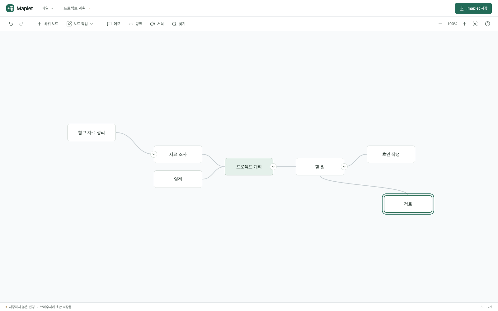

<p align="center">
  
</p>

<h1 align="center">Maplet</h1>

<p align="center">MindMup 호환을 지원하는 로컬 우선 마인드맵 에디터.</p>

<p align="center">
  <a href="README.md" lang="en">English</a> · <strong>한국어</strong>
</p>

[](https://github.com/sejoung/Maplet/actions/workflows/ci.yml)
[](https://github.com/sejoung/Maplet/actions/workflows/pages.yml)
[](LICENSE)
[](#빠른-시작)

[](.nvmrc)
[](package.json)
[](package.json)
[](package.json)
[](vite.config.ts)
[](playwright.config.ts)

**[Maplet 열기](https://sejoung.github.io/Maplet/) · [사용 설명서](https://sejoung.github.io/Maplet/manual/index.html) · [문제 제보](https://github.com/sejoung/Maplet/issues)**

`.maplet` 문서를 만들거나 MindMup `.mup` 파일을 가져와 생각을 정리하고 작업을 다운로드하세요. 로컬 편집은 계정이나 백엔드 없이 브라우저에서 실행되며 Google Drive는 선택적으로 연결합니다. 화면은 **한국어와 영어**를 지원합니다.



[빠른 시작](#빠른-시작) · [주요 기능](#주요-기능) · [단축키](#단축키) · [파일 형식](#파일-형식) · [Google Drive](#google-drive) · [개발](#개발) · [문서](#문서) · [기여](#기여)

## 빠른 시작

1. **데스크톱 Google Chrome**에서 [Maplet을 엽니다](https://sejoung.github.io/Maplet/).
2. 중심 주제부터 작성하거나 **파일 → 열기**로 문서를 가져옵니다. 노드를 더블클릭해 제목을 편집하고, `Tab`으로 하위 노드, `Enter`로 형제 노드를 만듭니다.
3. 노드를 끌어 가지를 배치하고, **다운로드** 또는 `Ctrl`/`⌘` + `S`로 `.maplet` 파일을 저장합니다.

처음에는 브라우저 언어를 따릅니다. **설정 → 언어**에서 바꾸면 다음 방문에도 유지되며 문서 내용은 변하지 않습니다. **사용 설명서** 단추는 현재 화면 언어에 맞는 [한국어](https://sejoung.github.io/Maplet/manual/index.html)·[영어](https://sejoung.github.io/Maplet/manual/en/index.html) 설명서를 엽니다.

브라우저 초안으로 기기의 작업을 복구할 수 있습니다. 작업 원본을 보관하거나 다른 기기로 옮기려면 `.maplet` 파일을 다운로드하세요. [Google Drive](#google-drive)를 연결하면 `Ctrl`/`⌘` + `S`는 Drive에 저장하며, **파일 → .maplet 다운로드**로 로컬 사본도 받을 수 있습니다.

공식 지원 브라우저는 데스크톱 Google Chrome이며 자동 브라우저 테스트에는 Chromium을 사용합니다. Firefox·Safari·모바일 브라우저는 현재 공식 지원 범위에서 제외합니다.

## 주요 기능

| 영역            | 할 수 있는 일                                                                                                                                       |
| --------------- | --------------------------------------------------------------------------------------------------------------------------------------------------- |
| 편집            | 노드 추가·이름 변경·삭제·순서 변경·부모 변경. 가지 전체 복사·잘라내기·붙여넣기·복제와 다른 앱의 들여쓰기·글머리표 목록 붙여넣기.                    |
| 선택과 배치     | 클릭·키보드·영역으로 여러 노드 선택. 부모와 하위 노드 함께 이동, 다른 노드에 놓아 부모 변경, 노드 너비 조절, 전체 자동 배치.                        |
| 글과 모양       | 글 일부나 선택한 노드에 굵게·기울임·형광펜 적용. 정렬, 글자 크기 3종과 시스템 글꼴 3종, 노드 색·테두리, 가지 선 모양, 아이콘, 할 일 체크 상자 설정. |
| 탐색과 연결     | 노드 찾기, 가지 접기, 표시 단계 선택, 가지에 집중, 확대·축소·팬·미니맵. 메모·링크와 노드 사이 교차 연결선 추가.                                     |
| 파일과 내보내기 | `.maplet` 저장, MindMup `.mup` 교환, 개요 가져오기·내보내기, PNG·SVG 다운로드, 인쇄와 PDF 저장.                                                     |
| 이력과 복구     | 편집과 가지 이동 실행 취소·다시 실행. 새 맵을 별도 탭에서 열고 브라우저 초안 복구. 설정에서 초안 보관 끄기·삭제.                                    |
| Google Drive    | 저장 폴더 선택, 변경을 모아 자동 저장, 즉시 수동 저장, 노드·속성 단위 외부 변경 병합과 충돌 항목 선택.                                              |

노드를 우클릭하거나 `Shift` + `F10`을 누르면 노드 작업 메뉴가 열리고, 빈 캔버스를 우클릭하면 맵 작업 메뉴가 열립니다. 드래그 중 `Alt`/`⌥`를 누르면 부모를 바꾸지 않고 자유롭게 배치하며, `Escape`로 취소합니다. 자세한 조작은 화면 캡처가 포함된 [사용 설명서](https://sejoung.github.io/Maplet/manual/index.html)를 참고하세요.

## 단축키

두 키가 함께 적힌 항목은 Windows/Linux에서 `Ctrl`, macOS에서 `⌘`를 사용합니다.

| 단축키                         | 동작                              |
| ------------------------------ | --------------------------------- |
| `Tab` / `Enter`                | 하위 / 형제 노드 추가             |
| `F2` / 더블클릭                | 제목 편집                         |
| 방향키                         | 계층 탐색                         |
| `Delete` / `Backspace`         | 선택한 노드와 모든 하위 노드 삭제 |
| `Ctrl` / `⌘` + `Z`             | 실행 취소                         |
| `Ctrl` / `⌘` + `Shift` + `Z`   | 다시 실행                         |
| `Ctrl` / `⌘` + `S`             | Drive 저장 / 로컬 다운로드        |
| `Ctrl` / `⌘` + `C` / `X` / `V` | 가지 복사 / 잘라내기 / 붙여넣기   |
| `Ctrl` / `⌘` + `D`             | 가지 복제                         |
| `Ctrl` / `⌘` + `F`             | 노드 찾기                         |
| `Ctrl` / `⌘` + `B` / `I`       | 굵게 / 기울임 전환                |
| `Ctrl` / `⌘` + `Shift` + `H`   | 현재 형광펜 색 적용·해제          |
| `Ctrl` / `⌘` + `\`             | 굵게·기울임·형광펜 해제           |
| `Alt` / `⌥` + `↑` / `↓`        | 형제 사이 순서 변경               |
| 우클릭 / `Shift` + `F10`       | 노드 메뉴 열기                    |
| `Shift` / `Ctrl` / `⌘` + 클릭  | 노드를 선택에 추가·제외           |
| 빈 곳에서 `Shift` + 드래그     | 영역으로 선택                     |
| `Shift` + 방향키               | 선택 넓히기                       |
| `Ctrl` / `⌘` + `A`             | 보이는 노드 모두 선택             |
| `Space` + 드래그               | 캔버스 이동                       |
| `Ctrl` + 휠 / 핀치             | 확대·축소                         |
| `Ctrl` / `⌘` + `+` / `-` / `0` | 확대 / 축소 / 화면 맞추기         |

제목 편집 중에는 `Enter`로 적용하고, `Shift` + `Enter`로 줄바꿈하고, `Escape`로 취소합니다. `Tab`은 제목을 적용한 뒤 하위 노드를 만들고 편집을 이어갑니다. 서식 단축키는 제목 편집 중 선택한 글에, 그 외에는 선택한 노드에 적용합니다. 드래그·제목 편집 중이 아닐 때 `Escape`를 누르면 여러 노드 선택을 해제합니다.

## 파일 형식

| 형식            | 가져오기 | 내보내기    | 용도                                                                    |
| --------------- | -------- | ----------- | ----------------------------------------------------------------------- |
| `.maplet`       | 지원     | 지원        | 계층·좌표·글 서식·메모·스타일·연결선을 담는 기본 작업 문서.             |
| `.mup`          | 지원     | 지원        | MindMup v1·v2·v3 교환과 v3 다중 루트. 가져온 원본 백업도 다운로드 가능. |
| Markdown / OPML | 지원     | 지원        | 계층형 개요, 메모, 링크.                                                |
| 들여쓰기 `.txt` | 지원     | —           | 텍스트 개요로 새 맵 만들기.                                             |
| PNG / SVG       | —        | 지원        | 맵을 이미지로 공유.                                                     |
| PDF             | —        | 인쇄로 저장 | 브라우저의 PDF 저장 기능 사용.                                          |

[전용 형식](docs/maplet-format.md)은 알 수 없는 문서·노드 필드를 보존합니다. MindMup을 가져오면 원본 메타데이터와 첨부를 유지하며, 이미지·HTML 첨부는 전용 렌더링 없이 보존합니다. 교차 연결선은 표시하고 편집할 수 있습니다. MUP 내보내기의 수동 위치는 **Maplet 전용** `attr["maplet:position"]` 확장에 저장하므로 다른 편집기에서 배치가 다를 수 있습니다. 개요로 내보낼 때는 서식·좌표·교차 연결·접기 상태를 포함하지 않습니다.

가져오기 한도는 **`.maplet` 50 MiB**, **`.mup`·개요 10 MiB**, **5,000개 노드**, **100단계**, **제목당 10,000자**입니다. 호환성 테스트는 합성 fixture를 사용하며, 지원 범위는 [호환성 매트릭스](docs/compatibility.md)에서 확인할 수 있습니다.

## Google Drive

**Google Drive** 단추에서 저장 폴더를 선택하면 자동 저장을 사용합니다. 편집이 멈춘 뒤 3초 후 저장하며 자동 업로드 사이에는 최소 5초, 연속 편집 중에는 최대 15초 간격을 적용합니다. `Ctrl`/`⌘` + `S`로 즉시 저장할 수 있습니다. 업로드 중에도 편집을 이어가면 최신 변경을 순서대로 저장하고, 외부 변경과 충돌하면 유지할 내용을 선택합니다.

선택한 폴더 밖에서 연 파일과 가져온 `.mup`은 원본을 보존하고 저장 폴더에 `.maplet` 사본으로 저장합니다. 상단 파일 이름을 클릭해 이름을 바꿀 수 있습니다. 파일명을 정하지 않았다면 처음 확정한 루트 제목으로 채우고, 이후 제목을 바꿔도 파일명은 유지합니다.

인증 정보는 메모리에만 두며 연결된 다른 Maplet 탭과 공유할 수 있습니다. 연결된 탭이 남아 있지 않으면 새로고침 후 다시 연결해야 하며, 저장 위치는 기억합니다. 헤더에서 연결·저장 상태를 확인하고 토큰 만료가 가까워지면 연결을 연장할 수 있습니다. 설정과 동기화 동작은 [Drive 설정·운영 가이드](docs/google-drive.md)를 참고하세요.

## 개발

**Node.js 24**와 npm을 사용합니다. React·TypeScript·Vite로 만들었으며 테스트 도구는 Vitest와 Playwright입니다.

```sh
git clone https://github.com/sejoung/Maplet.git
cd Maplet
npm ci
npm run dev
```

[http://127.0.0.1:5173](http://127.0.0.1:5173)에 접속하세요. 로컬 편집에는 환경 변수가 필요하지 않습니다. Drive를 사용하려면 [`.env.example`](.env.example)을 `.env.local`로 복사해 공개 Google 설정을 입력하고 [Drive 설정 가이드](docs/google-drive.md)를 따릅니다. 브라우저 빌드에는 client secret 없이 공개 설정만 사용합니다.

```sh
# 포맷, 린트, 타입, 단위/통합/아키텍처 테스트, 커버리지, 빌드
npm run verify

# 브라우저 회귀·접근성 테스트
npx playwright install chromium
npm run test:e2e
```

개발 중에는 `npm run test:watch`로 테스트를 감시하고, `npm run arch`로 의존성을 검사하며, `npm run arch:graph`로 의존 그래프를 확인합니다. `npm run manual:capture`는 두 언어 사용 설명서의 화면 캡처를 갱신합니다. 번역 카탈로그는 [`src/i18n/locales/`](src/i18n/locales/)에 있습니다.

[Quality workflow](.github/workflows/ci.yml)는 전체 검증과 Chromium E2E를 실행하며, [Pages workflow](.github/workflows/pages.yml)도 배포 전에 같은 검사를 실행합니다. 운영 CSS를 포함한 코드 파일은 **400줄**, `src`·`tests`·`scripts`의 각 폴더는 파일 **10개**로 제한합니다. 아키텍처 규칙과 기여 절차는 [개발 가이드](docs/contributing.md)를 참고하세요.

테스트 로그·커버리지·브라우저 보고서는 실행별로 `test-results/`에 저장하고 CI artifact로 보관합니다. 최근 완료 결과는 `test-results/latest/summary.json`, `test-results/latest-coverage/coverage/index.html`, `test-results/latest-e2e/html/index.html`에서 확인합니다. 브라우저 보고서는 다음 명령으로 엽니다.

```sh
npx playwright show-report test-results/latest-e2e/html
```

### 프로젝트 구조

```text
src/
  app/           앱 조립, 문서 수명주기, 초안, Drive 훅
  components/    캔버스, 글 편집, 도구 모음, 메뉴, 대화상자
  domain/        맵 모델, 편집 명령, 스타일, 병합 규칙
  application/   히스토리와 Drive 동기화
  adapters/      파일 변환, 브라우저 저장소, 외부 서비스
  engine/        레이아웃, 기하, 연결선, SVG 내보내기
  i18n/          한국어·영어 메시지 카탈로그
  styles/        앱 스타일
tests/           단위·통합·아키텍처·브라우저 테스트와 fixture
public/manual/   화면 캡처가 포함된 사용 설명서
docs/            개발 가이드, 호환성, 아키텍처 결정 기록
```

### 직접 호스팅

```sh
npm run build
npm run preview
```

`dist/`를 정적 호스팅에 배포합니다. 상대 자산 경로로 저장소 하위 경로도 지원합니다. GitHub Pages는 배포 원본을 GitHub Actions로 설정한 뒤 [Pages workflow](.github/workflows/pages.yml)를 수동 실행합니다. Drive를 사용한다면 배포 origin 설정과 재빌드가 필요합니다.

## 문서

사용 설명서는 두 언어로 제공하며, 상세 개발 가이드는 현재 한국어로 작성되어 있습니다.

| 문서                                                                                                                                         | 내용                                       |
| -------------------------------------------------------------------------------------------------------------------------------------------- | ------------------------------------------ |
| [사용 설명서: 한국어](https://sejoung.github.io/Maplet/manual/index.html) / [English](https://sejoung.github.io/Maplet/manual/en/index.html) | 화면으로 보는 편집·배치·파일·Drive 사용법. |
| [개발 가이드](docs/contributing.md)                                                                                                          | TDD, 아키텍처 검사, 테스트 보고서, 배포.   |
| [디자인 가이드](docs/design-guide.md)                                                                                                        | 가독성, 색상, 조작, 접근성.                |
| [전용 형식](docs/maplet-format.md)                                                                                                           | `.maplet` 스키마, 메타데이터, 이전 정책.   |
| [호환성](docs/compatibility.md)                                                                                                              | 가져오기·내보내기 지원과 원본 보존.        |
| [Google Drive](docs/google-drive.md)                                                                                                         | 선택적 연결 설정, 저장, 운영 검증.         |
| [검증 기록](docs/verification.md)                                                                                                            | 구현 범위, 검증 근거, 남은 검증.           |
| [아키텍처 결정 기록](docs/adr/)                                                                                                              | 설계 결정과 배경.                          |
| [초기 제품 기획](docs/product-brief.md)                                                                                                      | 최초 제품 목표와 수용 기준 보관.           |

## 기여

버그 제보, 수정, 접근성 개선, 번역을 환영합니다. 재현 순서와 함께 [이슈](https://github.com/sejoung/Maplet/issues)를 남겨 주세요. 맵 파일이 필요하다면 민감한 내용을 제거한 샘플을 사용하세요.

코드를 바꿀 때는 실패하는 회귀 테스트를 먼저 추가하고, 테스트는 `tests/`, 운영 코드는 `src/`에 분리하며, `npm run verify`와 관련 E2E를 실행합니다. 아키텍처 변경은 `docs/adr/`에 기록합니다. README를 수정하면 [한국어](README.ko.md)와 [English](README.md)를 함께 갱신합니다. 자세한 절차는 [개발 가이드](docs/contributing.md)를 참고하세요.

## 라이선스

[MIT](LICENSE) © 2026 sejoung kim.
