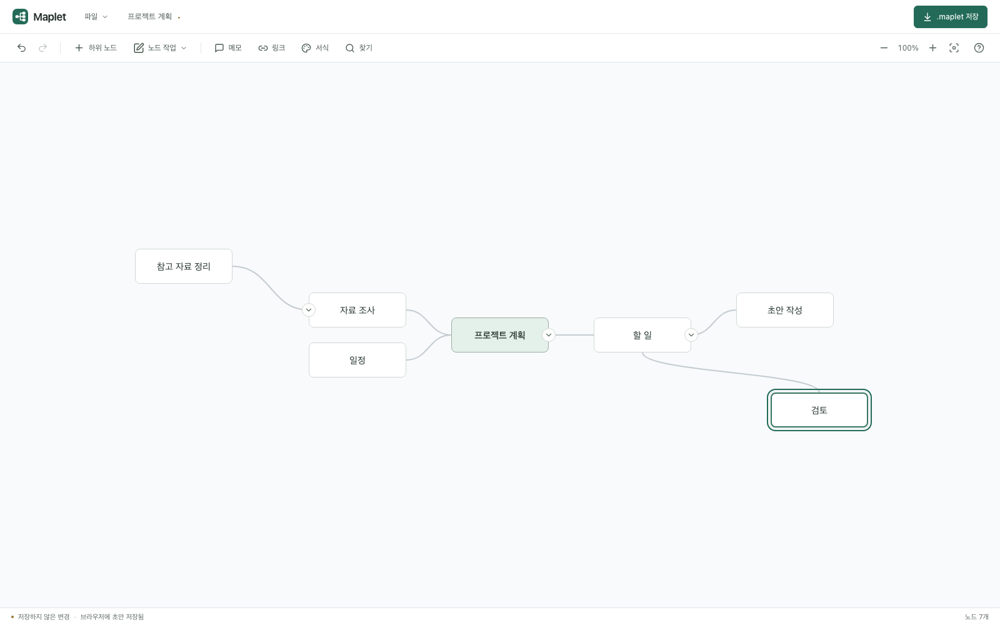

<p align="center">
  
</p>

<h1 align="center">Maplet</h1>

<p align="center">A local-first mind map editor with MindMup compatibility.</p>

<p align="center">
  <strong>English</strong> · <a href="README.ko.md" lang="ko">한국어</a>
</p>

[](https://github.com/sejoung/Maplet/actions/workflows/ci.yml)
[](https://github.com/sejoung/Maplet/actions/workflows/pages.yml)
[](LICENSE)
[](#quick-start)

[](.nvmrc)
[](package.json)
[](package.json)
[](package.json)
[](vite.config.ts)
[](playwright.config.ts)

**[Open Maplet](https://sejoung.github.io/Maplet/) · [User guide](https://sejoung.github.io/Maplet/manual/en/index.html) · [Report an issue](https://github.com/sejoung/Maplet/issues)**

Create `.maplet` documents or import MindMup `.mup` files, arrange your ideas, and download your work. Local editing runs in your browser without an account or backend. Google Drive is optional. The interface supports **English and Korean**.



[Quick start](#quick-start) · [Features](#features) · [Keyboard shortcuts](#keyboard-shortcuts) · [Document formats](#document-formats) · [Google Drive](#google-drive) · [Development](#development) · [Documentation](#documentation) · [Contributing](#contributing)

## Quick start

1. [Open Maplet](https://sejoung.github.io/Maplet/) in **desktop Google Chrome**.
2. Start with the central topic, or choose **File → Open** to import a document. Double-click a node to edit its title; use `Tab` for a child and `Enter` for a sibling.
3. Drag nodes to arrange branches, then use **Download** or `Ctrl`/`⌘` + `S` to save a `.maplet` file locally.

The interface initially follows your browser language. Change it through **Settings → Language**; the choice is remembered and document contents stay unchanged. The **User guide** button opens the illustrated [English](https://sejoung.github.io/Maplet/manual/en/index.html) or [Korean](https://sejoung.github.io/Maplet/manual/index.html) guide in the current interface language.

Browser drafts help recover local work. Download a `.maplet` file to keep a portable copy or move it to another device. When [Google Drive](#google-drive) is connected, `Ctrl`/`⌘` + `S` saves to Drive; **File → Download .maplet** still downloads a local copy.

Desktop Google Chrome is the supported browser, with automated tests in Chromium. Firefox, Safari, and mobile browsers are outside the current support scope.

## Features

| Area                       | What you can do                                                                                                                                                                                             |
| -------------------------- | ----------------------------------------------------------------------------------------------------------------------------------------------------------------------------------------------------------- |
| Editing                    | Create, rename, delete, reorder, and reparent nodes. Copy, cut, paste, and duplicate whole branches; paste indented or bulleted lists from other apps.                                                      |
| Selection and layout       | Select several nodes by click, keyboard, or area. Move a parent with its descendants, drag onto another node to reparent, resize node widths, or auto-arrange the whole map.                                |
| Text and appearance        | Apply bold, italic, and highlighter colors to text or selected nodes. Choose alignment, three font sizes and system font families, node colors and borders, branch line styles, icons, and task checkboxes. |
| Navigation and connections | Find nodes, collapse branches, show selected levels, focus on one branch, zoom, pan, and use the minimap. Add notes, links, and cross-link arrows between nodes.                                            |
| Files and exports          | Save native `.maplet` documents, exchange MindMup `.mup` files, import and export outlines, download PNG/SVG images, and print or save as PDF.                                                              |
| History and recovery       | Undo and redo edits and whole-branch moves. Open new maps in separate tabs and recover browser drafts; draft storage can be disabled or cleared in Settings.                                                |
| Google Drive               | Choose a save folder, batch automatic uploads, save manually, and merge external changes by node and property, with choices for conflicting edits.                                                          |

Right-click a node or press `Shift` + `F10` for its actions. Right-click the empty canvas for map actions. During a drag, hold `Alt`/`⌥` to place freely without changing the parent, or press `Escape` to cancel. See the [user guide](https://sejoung.github.io/Maplet/manual/en/index.html) for illustrated workflows.

## Keyboard shortcuts

Use `Ctrl` on Windows/Linux and `⌘` on macOS where both are listed.

| Shortcut                       | Action                                        |
| ------------------------------ | --------------------------------------------- |
| `Tab` / `Enter`                | Add a child / sibling                         |
| `F2` / double-click            | Edit a title                                  |
| Arrow keys                     | Navigate the hierarchy                        |
| `Delete` / `Backspace`         | Delete selected nodes and their descendants   |
| `Ctrl` / `⌘` + `Z`             | Undo                                          |
| `Ctrl` / `⌘` + `Shift` + `Z`   | Redo                                          |
| `Ctrl` / `⌘` + `S`             | Save to Drive / download locally              |
| `Ctrl` / `⌘` + `C` / `X` / `V` | Copy / cut / paste branches                   |
| `Ctrl` / `⌘` + `D`             | Duplicate branches                            |
| `Ctrl` / `⌘` + `F`             | Find nodes                                    |
| `Ctrl` / `⌘` + `B` / `I`       | Toggle bold / italic                          |
| `Ctrl` / `⌘` + `Shift` + `H`   | Apply or remove the current highlighter color |
| `Ctrl` / `⌘` + `\`             | Clear bold, italic, and highlights            |
| `Alt` / `⌥` + `↑` / `↓`        | Reorder siblings                              |
| Right-click / `Shift` + `F10`  | Open the node menu                            |
| `Shift` / `Ctrl` / `⌘` + click | Add or remove a node from the selection       |
| `Shift` + drag on empty canvas | Select an area                                |
| `Shift` + arrow keys           | Extend the selection                          |
| `Ctrl` / `⌘` + `A`             | Select all visible nodes                      |
| `Space` + drag                 | Pan the canvas                                |
| `Ctrl` + wheel / pinch         | Zoom                                          |
| `Ctrl` / `⌘` + `+` / `-` / `0` | Zoom in / zoom out / fit to screen            |

While editing a title, `Enter` applies, `Shift` + `Enter` inserts a newline, `Escape` cancels, and `Tab` applies the title and starts editing a child. Formatting shortcuts apply to the selected text while editing, or to selected nodes otherwise. Outside a drag or title editor, `Escape` clears a multi-node selection.

## Document formats

| Format          | Import | Export    | Purpose                                                                                             |
| --------------- | ------ | --------- | --------------------------------------------------------------------------------------------------- |
| `.maplet`       | Yes    | Yes       | Native working document: hierarchy, positions, text formatting, notes, styles, and connections.     |
| `.mup`          | Yes    | Yes       | MindMup v1/v2/v3 exchange, including multiple roots in v3; original backups can also be downloaded. |
| Markdown / OPML | Yes    | Yes       | Hierarchical outlines, notes, and links.                                                            |
| Indented `.txt` | Yes    | —         | Create a map from a text outline.                                                                   |
| PNG / SVG       | —      | Yes       | Share an image of the map.                                                                          |
| PDF             | —      | Via print | Use the browser's Save as PDF option.                                                               |

The [native format](docs/maplet-format.md) preserves unknown document and node fields. MindMup imports retain original metadata and attachments; images and HTML attachments are preserved without dedicated rendering. Cross-links are displayed and editable. MUP exports store manual positions in the **Maplet-specific** `attr["maplet:position"]` extension, so other editors may lay out the map differently. Outline exports omit formatting, coordinates, cross-links, and collapsed states.

Import limits are **50 MiB for `.maplet`**, **10 MiB for `.mup` and outlines**, **5,000 nodes**, **100 levels**, and **10,000 characters per title**. Compatibility tests use synthetic fixtures; see the [compatibility matrix](docs/compatibility.md) for the supported scope.

## Google Drive

Choose a save folder from the **Google Drive** button to enable automatic saving. Edits are batched after 3 seconds of inactivity, with at least 5 seconds between automatic uploads and a save after at most 15 seconds of continuous editing. `Ctrl`/`⌘` + `S` saves immediately. You can keep editing during uploads; newer changes are saved in order, and conflicts prompt you to choose what to keep.

Files opened outside the chosen folder and imported `.mup` files are saved as new `.maplet` copies in that folder, preserving their originals. Rename the document by clicking its filename in the header. If no filename was chosen, the first committed root title supplies it; later title edits keep that filename.

Credentials stay in memory and can be shared with other connected Maplet tabs. If no connected tab remains, reconnect after reloading; the save location is remembered. The header shows connection and save status and offers extension near token expiry. See the [Drive setup and operation guide](docs/google-drive.md) for configuration and sync behavior.

## Development

Use **Node.js 24** and npm. Built with React, TypeScript, and Vite; tests use Vitest and Playwright.

```sh
git clone https://github.com/sejoung/Maplet.git
cd Maplet
npm ci
npm run dev
```

Open [http://127.0.0.1:5173](http://127.0.0.1:5173). Local editing needs no environment variables. For Drive, copy [`.env.example`](.env.example) to `.env.local`, set the public Google configuration, and follow the [Drive setup guide](docs/google-drive.md). Browser builds use public configuration, without a client secret.

```sh
# Formatting, lint, types, unit/integration/architecture tests, coverage, and build
npm run verify

# Browser regression and accessibility tests
npx playwright install chromium
npm run test:e2e
```

Use `npm run test:watch` while developing, `npm run arch` to check dependencies, and `npm run arch:graph` for the dependency graph. `npm run manual:capture` refreshes the illustrated guides' screenshots in both languages. Translation catalogs live in [`src/i18n/locales/`](src/i18n/locales/).

The [Quality workflow](.github/workflows/ci.yml) runs verification and Chromium E2E checks; the [Pages workflow](.github/workflows/pages.yml) also checks before deployment. Code files, including source CSS, are limited to **400 lines**; folders in `src`, `tests`, and `scripts` hold at most **10 files**. See the [development guide](docs/contributing.md) for architecture rules and the contribution workflow.

Test logs, coverage, and browser reports are saved per run in `test-results/` and uploaded as CI artifacts. The latest completed runs are available through `test-results/latest/summary.json`, `test-results/latest-coverage/coverage/index.html`, and `test-results/latest-e2e/html/index.html`. Open the browser report with:

```sh
npx playwright show-report test-results/latest-e2e/html
```

### Project structure

```text
src/
  app/           Application assembly, document lifecycle, drafts, and Drive hooks
  components/    Canvas, rich text, toolbars, menus, and dialogs
  domain/        Map model, editing commands, styles, and merge rules
  application/   History and Drive synchronization
  adapters/      File codecs, browser storage, and external services
  engine/        Layout, geometry, connections, and SVG export
  i18n/          English and Korean message catalogs
  styles/        Application styles
tests/           Unit, integration, architecture, and browser tests; fixtures
public/manual/   Illustrated user guides and screenshots
docs/            Developer guides, compatibility, and architecture decisions
```

### Self-hosting

```sh
npm run build
npm run preview
```

Deploy `dist/` to a static host. Relative asset paths support repository subpaths. For GitHub Pages, set GitHub Actions as the Pages source and run the [Pages workflow](.github/workflows/pages.yml) manually. Drive requires configuration for the deployed origin and a rebuild.

## Documentation

The user guide is available in both languages; detailed developer guides are currently in Korean.

| Document                                                                                                                                    | Topics                                                   |
| ------------------------------------------------------------------------------------------------------------------------------------------- | -------------------------------------------------------- |
| [User guide: English](https://sejoung.github.io/Maplet/manual/en/index.html) / [한국어](https://sejoung.github.io/Maplet/manual/index.html) | Illustrated editing, layout, files, and Drive workflows. |
| [Development guide](docs/contributing.md)                                                                                                   | TDD, architecture checks, test reports, and deployment.  |
| [Design guide](docs/design-guide.md)                                                                                                        | Readability, colors, interaction, and accessibility.     |
| [Native format](docs/maplet-format.md)                                                                                                      | `.maplet` schema, metadata, and migration.               |
| [Compatibility](docs/compatibility.md)                                                                                                      | Import/export support and preservation rules.            |
| [Google Drive](docs/google-drive.md)                                                                                                        | Optional configuration, saving, and deployment checks.   |
| [Verification](docs/verification.md)                                                                                                        | Implemented scope, evidence, and remaining validation.   |
| [Architecture decisions](docs/adr/)                                                                                                         | Design decisions and their rationale.                    |
| [Original product brief](docs/product-brief.md)                                                                                             | Historical goals and acceptance criteria.                |

## Contributing

Bug reports, fixes, accessibility improvements, and translations are welcome. [Open an issue](https://github.com/sejoung/Maplet/issues) with reproduction steps and an anonymized map if needed.

For code changes, add a failing regression test first, keep tests in `tests/` and production code in `src/`, and run `npm run verify` plus relevant E2E tests. Record architecture changes in `docs/adr/`. Update both [English](README.md) and [한국어](README.ko.md) when changing README content. See the [development guide](docs/contributing.md) for details.

## License

[MIT](LICENSE) © 2026 sejoung kim.
