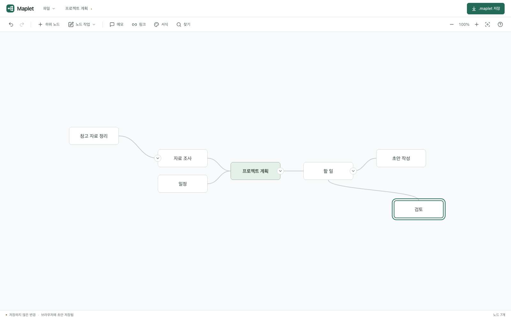

<p align="center">
  
</p>

<h1 align="center">Maplet</h1>

<p align="center">A local-first mind map editor with MindMup compatibility.</p>

<p align="center">
  <strong>English</strong> · <a href="README.ko.md" lang="ko">한국어</a>
</p>

[](https://github.com/sejoung/Maplet/actions/workflows/ci.yml)
[](LICENSE)
[](.nvmrc)
[](package.json)

Create `.maplet` documents or import `.mup` files, arrange your ideas, and download your changes. Maplet keeps editing in your browser, with a simple toolbar and a readable canvas. Local file editing requires no account or backend. Google Drive is optional.



[Quick start](#quick-start) · [Features](#features) · [Development](#development) · [Contributing](#contributing)

The officially supported browser is **desktop Google Chrome**. Automated browser tests use Chromium. Firefox, Safari, and mobile browsers are outside the current support scope.

## Features

- **Node dimensions:** drag the corner horizontally to change width; height follows the text using actual font measurements. Double-click the corner to restore automatic sizing. Small −/+ controls collapse and expand branches.
- **Formatting and markers:** three alignments, sizes and system font families, bold and italic, background and border colors, branch line colors and dash styles that descendants inherit, one of ten icons, and a task checkbox you can tick on the node. Cross-links draw arrows between any two nodes. Light and dark themes follow the system or your choice in Settings.
- **Native documents:** save `.maplet` files with a versioned JSON model for hierarchy, coordinates, notes, and styles.
- **MindMup compatibility:** import `.mup` files, export compatible copies, and download an untouched MindMup original backup.
- **Direct editing:** create, rename, delete, and reparent nodes; add notes, links, and optional background colors from the toolbar.
- **Node menu and branch editing:** right-click a node (or press `Shift`+`F10`) for every node action in one menu. Copy, cut, paste, and duplicate branches, and reorder siblings. Pasting an indented or bulleted list from another app creates nodes that follow its hierarchy; copied branches paste into other apps as an indented outline.
- **Select several nodes:** `Shift`/`Ctrl`/`⌘`-click nodes, `Shift`-drag an area on the empty canvas, extend with `Shift`+arrow keys, or press `Ctrl`/`⌘`+`A` for every visible node. Delete, copy, cut, duplicate, move, side, and style changes apply to the whole selection in one undo step; drag any selected node to move the group together. `Escape` or a click on the empty canvas returns to one node.
- **Drag to reparent:** bring a dragged node within 16px of another node (or onto it) to make it that node's child; the target is highlighted and the connector follows. The rest of the map holds still while you drag, so targets never slip away; a caught target is kept until the gap exceeds 32px. Dropping onto a central topic picks its left or right side. Selected groups move and reparent together.
- **Export, outlines and print:** download the map as PNG or SVG, Markdown or OPML, or print it (and save as PDF) from the File menu. Markdown, OPML and indented text files open as new maps.
- **Move whole branches:** drag a parent and all its descendants together, preserving their relative positions. Connections follow as you move. Dashed guides show where overlapping branches will make room — including their empty interiors, keeping a 24px gap between groups' nodes — and they move there on release. Hold `Alt`/`⌥` to place freely next to other nodes without reparenting; branches then move aside live. Press Escape to restore the original positions. A hint at the bottom of the canvas shows the current mode.
- **Arrange the whole map:** use `Auto arrange` in the toolbar to balance branches by their actual height, separate major branches, and fit the result on screen. One undo restores the previous arrangement. Content, hierarchy, formatting, and collapsed states are preserved.
- **Navigate your map:** find nodes with a find bar (`Ctrl`/`⌘`+`F`) that highlights matches, show all levels or only the first two or three from the View menu, focus on one branch, use the minimap, zoom, pan, and fit to screen.
- **Undo and recovery:** undo or redo a whole drag in one step; recover browser drafts from IndexedDB and keep manual positions when reopening files.
- **Optional Google Drive:** choose a save folder first to batch later changes: 3 seconds after editing stops, at least 5 seconds between automatic uploads, and at most 15 seconds of continuous editing before a save. Unchanged snapshots are skipped; manual saves flush immediately. Credentials stay in memory only, so use Reconnect after every reload. The folder and file location are remembered. Files opened from other folders are saved as copies in the selected folder. Imported .mup originals are preserved; external changes are merged by node and property, with explicit resolution for conflicting edits.

The current app interface is in Korean. Both README versions describe the same features and commands.

## Quick start

Use **Node.js 24** and npm.

```sh
git clone https://github.com/sejoung/Maplet.git
cd Maplet
npm ci
npm run dev
```

Open [http://127.0.0.1:5173](http://127.0.0.1:5173). Start from the central topic or open a file through **파일 → 열기** (File → Open). Double-click a node to edit it, drag it to move its branch, and use **다운로드** (Download, Ctrl/Cmd+S) in the header to download the document. Use **파일 → .mup 다운로드 (MindMup 호환)** for a MindMup-compatible copy.

When Drive is connected, the primary Save button and Ctrl/Cmd+S save to Drive. Use **File → Download .maplet** for a local copy. The header shows editing, pending, saving, synced, error and reconnect states beneath the Drive button.

Keep editing during saves: newer changes are coalesced and saved sequentially. External changes to different nodes or properties merge automatically. Conflicting property edits, deletions and structural changes prompt you to choose what to keep.

Click the filename in the header to rename it. Press Enter or click outside to apply; Escape cancels. Downloads and Drive saves use the new name while node titles stay unchanged. Filename-only edits can also be recovered from the browser draft.

If you start writing before choosing a filename, the first committed root title supplies it. Later root edits keep that filename. Explicitly chosen names and opened filenames are preserved.

Local editing works without environment variables. To enable Drive, copy [`.env.example`](.env.example) to `.env.local`, fill in the public Google configuration, and follow the [Drive setup guide](docs/google-drive.md) (Korean). Never include a client secret in a browser build.

The interface supports Korean and English, initially following your browser language. Open **Settings → Language** in the top-right corner to change it immediately; your choice is remembered for future visits. The footer also provides a quick language selector. Changing language preserves document contents. Translations use Korean source messages as keys in [`src/i18n/locales/en.json`](src/i18n/locales/en.json).

## Keyboard shortcuts

| Shortcut                       | Action                                                  |
| ------------------------------ | ------------------------------------------------------- |
| `Tab`                          | Add a child                                             |
| `Enter`                        | Add a sibling                                           |
| `F2` / double-click            | Edit a title                                            |
| Arrow keys                     | Navigate the hierarchy                                  |
| `Delete` / `Backspace`         | Delete a node and its descendants                       |
| `Ctrl` / `⌘` + `Z`             | Undo                                                    |
| `Ctrl` / `⌘` + `Shift` + `Z`   | Redo                                                    |
| `Ctrl` / `⌘` + `S`             | Save to Drive / download locally                        |
| `Space` + drag                 | Pan the canvas                                          |
| `Ctrl` + wheel / pinch         | Zoom                                                    |
| `Ctrl` / `⌘` + `+` `-` `0`     | Zoom in, zoom out, fit                                  |
| `Ctrl` / `⌘` + `C` `X` `V`     | Copy, cut, paste a branch                               |
| `Ctrl` / `⌘` + `D`             | Duplicate a branch                                      |
| `Alt` + `↑` / `↓`              | Reorder among siblings                                  |
| Right-click / `Shift` + `F10`  | Node menu                                               |
| Right-click empty canvas       | Map menu (undo, paste, select all, find, arrange, zoom) |
| `Shift` / `Ctrl` / `⌘` + click | Add or remove a node from the selection                 |
| `Shift` + drag on empty canvas | Select an area                                          |
| `Shift` + arrow keys           | Extend the selection                                    |
| `Ctrl` / `⌘` + `A`             | Select all visible nodes                                |
| Drop next to or onto a node    | Move under that node                                    |

While editing a title: `Enter` applies, `Shift` + `Enter` inserts a newline, `Escape` cancels, and `Tab` applies the title and starts a child. During a drag, `Escape` cancels the whole branch movement; otherwise it clears a multi-node selection.

## Document formats

The default [`.maplet` format](docs/maplet-format.md) stores node coordinates and hierarchy directly in a versioned JSON document. Unknown native document and node fields are preserved. Existing browser drafts are migrated when recovered.

MindMup v1, v2, and v3 are supported for import/export, including multiple roots in v3. Original metadata and imported text are kept in a separate compatibility section. MUP exports retain positions in the **Maplet-specific** `attr["maplet:position"]` extension; other editors may display a different layout. Native saving and MUP export are separate actions.

Images, HTML attachments, and cross-links are preserved as data but do not have dedicated rendering. Compatibility tests currently use synthetic fixtures; full compatibility with every MindMup file is not guaranteed. See the [compatibility matrix](docs/compatibility.md) and [verification record](docs/verification.md) (Korean).

Import limits: **50 MiB for `.maplet`**, **10 MiB for `.mup`**, **5,000 nodes**, **100 levels**, and **10,000 characters per title**. Download `.maplet` files for a portable working copy; browser drafts are stored separately on the current device. Saving a Drive-imported `.mup` creates a new `.maplet` file and keeps the original untouched.

## Development

Built with React, TypeScript, Vite, and an SVG-based layout renderer. Tests use Vitest and Playwright.

```sh
# Formatting, lint, types, unit/integration/architecture tests, coverage, and build
npm run verify

# Browser regression tests
npx playwright install chromium
npm run test:e2e

# Watch tests while developing
npm run test:watch
```

The quality and Pages workflows run verification and desktop Chromium E2E tests, including accessibility checks, with at most two test workers in CI. Layer boundaries and circular dependencies are enforced by architecture tests. Code files are limited to **400 lines**, including comments and blank lines; source CSS has the same limit.

Each npm test command saves logs and reports in `test-results/<UTC timestamp>-<kind>-<unique suffix>/`. Relative symlinks point to the latest completed run, including failures:

| Path                                               | Contents                                                   |
| -------------------------------------------------- | ---------------------------------------------------------- |
| `test-results/latest/summary.json`                 | Most recent run status, command, timestamps, and exit code |
| `test-results/latest-coverage/coverage/index.html` | Latest coverage report                                     |
| `test-results/latest-e2e/html/index.html`          | Latest browser report                                      |

Results are ignored by Git and uploaded as CI artifacts. Open the latest browser report with:

```sh
npx playwright show-report test-results/latest-e2e/html
```

### Project structure

```text
src/
  app/           Application assembly, document lifecycle, Drive coordination
  components/    Toolbar, canvas, node editing, dialogs
  domain/        Map model and editing commands
  application/   History and use cases
  adapters/      Maplet/MindMup codecs, file I/O, IndexedDB, Google Drive
  engine/        Layout and connection geometry
  styles/        Base, editor, canvas, dialog, and responsive styles
tests/
  unit/          Domain, layout, codec, and adapter tests
  integration/   Draft storage and development tooling tests
  architecture/  Dependency boundaries and cycle checks
  e2e/           Browser scenarios
  fixtures/      Native and synthetic MindMup samples
docs/            Guides, screenshots, and architecture decisions
```

### Self-hosting

```sh
npm run build
npm run preview
```

Deploy `dist/` to a static host. Asset paths are relative, so repository subpaths are supported. The [Pages workflow](.github/workflows/pages.yml) provides manual GitHub Pages deployment; enable GitHub Actions as the Pages source before running it. Drive requires configuration for the deployed origin and a rebuild.

## Documentation

Detailed guides are currently in Korean.

| Document                                        | Topics                                                |
| ----------------------------------------------- | ----------------------------------------------------- |
| [Design guide](docs/design-guide.md)            | Readability, colors, interaction, and accessibility   |
| [Development guide](docs/contributing.md)       | TDD, quality checks, test artifacts, and deployment   |
| [Native format](docs/maplet-format.md)          | Versioned `.maplet` schema, metadata, and migration   |
| [Compatibility](docs/compatibility.md)          | Supported formats and preservation rules              |
| [Google Drive](docs/google-drive.md)            | Optional configuration and deployment checks          |
| [Verification](docs/verification.md)            | Implemented scope, evidence, and remaining validation |
| [Architecture decisions](docs/adr/)             | Layers, file formats, UI, dragging, and tooling       |
| [Original product brief](docs/product-brief.md) | Historical goals and acceptance criteria              |

## Contributing

Bug reports, fixes, accessibility improvements, and documentation translations are welcome. [Open an issue](https://github.com/sejoung/Maplet/issues) with steps to reproduce a problem. If a map is needed, use an anonymized sample.

For code changes, add a failing regression test first, keep tests in `tests/` and production code in `src/`, and run `npm run verify` plus the relevant E2E tests before opening a pull request. Record architectural changes in `docs/adr/`. See the [development guide](docs/contributing.md) for the full workflow.

When changing README content, update both [English](README.md) and [한국어](README.ko.md).

## License

[MIT](LICENSE) © 2026 sejoung kim.
